# Glypdl

<div align="center">
  
  <h3>A modern, blazing-fast cross-platform media downloader powered by yt-dlp and FFmpeg</h3>
  <p>Native applications built with <b>Android (Jetpack Compose / Kotlin)</b>, <b>Windows 11 (WinUI 3 / C# / .NET 8)</b>, and <b>Linux (GTK4 / libadwaita / Python)</b>.</p>

  <p>
    <a href="https://github.com/sureshsoudararajan/Glypdl/releases/latest"></a>
    <a href="LICENSE"></a>
    
    
    
    
    
    
  </p>
</div>

---

## 🌟 Overview

**Glypdl** is an ultra-fast, modern, fully open-source cross-platform media downloader powered by **yt-dlp** and **FFmpeg**. Designed from the ground up to feel completely native on every operating system, Glypdl avoids slow web wrappers in favor of first-class native UI frameworks:

* 📱 **Android Edition**: 100% native **Kotlin** and **Jetpack Compose (Material 3)**. Features background foreground service with persistent notifications, built-in in-app authenticated browser with cookie preservation, YouTube multi-language audio track selection, subtitles support, and Android system share sheet integration.
* 🪟 **Windows Edition**: Native **WinUI 3**, **C#**, and **.NET 8** with Windows 11 Fluent 2 design, translucent Mica material backdrops, automatic dark/light theme switching, and an Inno Setup installer.
* 🐧 **Linux Edition**: Native **GTK4**, **libadwaita**, and **Python 3.10+** adhering to the GNOME Human Interface Guidelines (HIG), packaged as standalone AppImage, Flatpak, Deb, RPM, and Arch Linux packages, complete with a Firefox/LibreWolf companion extension.

---

## 📸 Screenshots

### 📱 Android Application (Jetpack Compose & Material 3)
<div align="center">
  <table>
    <tr>
      <td align="center"><b>Home & URL Detection</b><br/>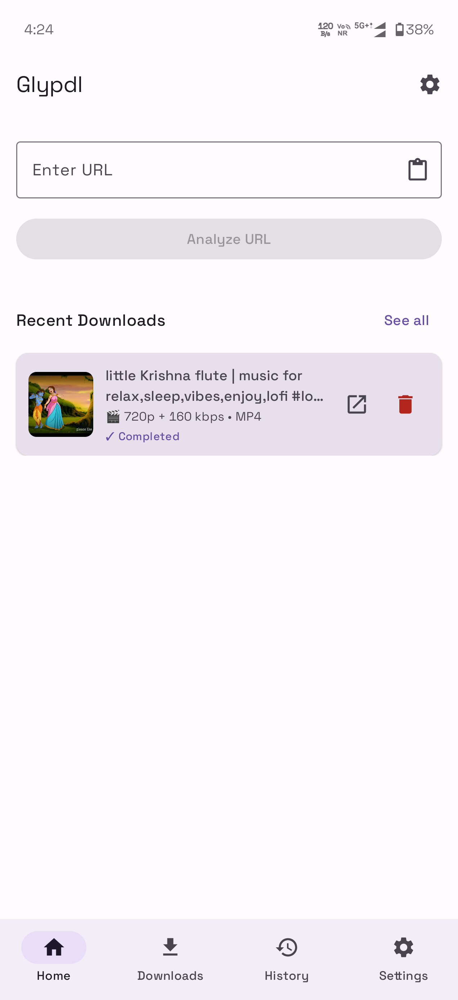</td>
      <td align="center"><b>Downloads Queue</b><br/>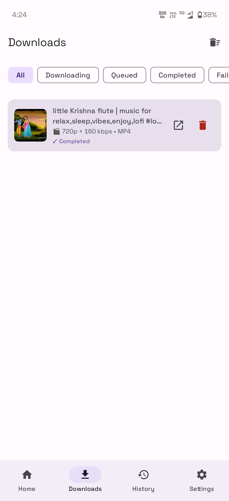</td>
      <td align="center"><b>Download History</b><br/>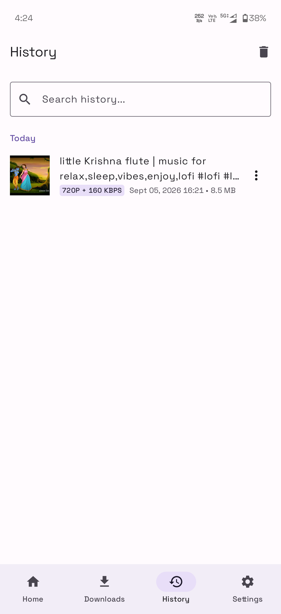</td>
      <td align="center"><b>Preferences & Engine</b><br/>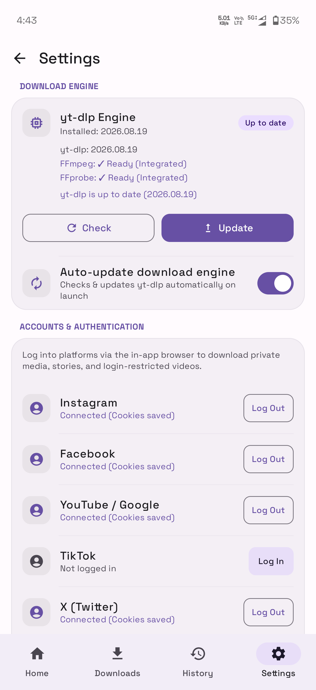</td>
    </tr>
  </table>
</div>

### 🐧 Linux Desktop Application (GTK4 & libadwaita)
<div align="center">
  <table>
    <tr>
      <td align="center"><b>Active Downloads Queue</b><br/>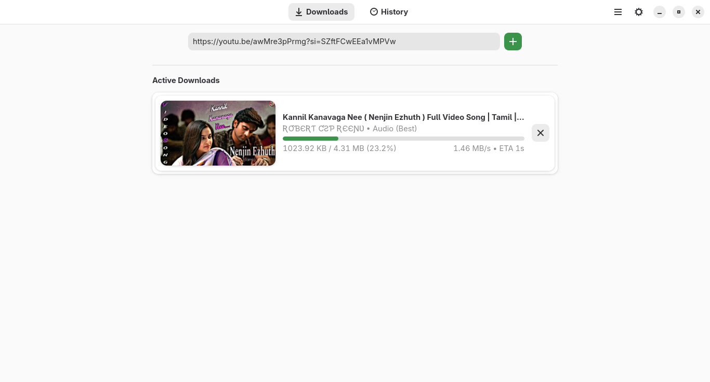</td>
      <td align="center"><b>Metadata & Format Selection</b><br/>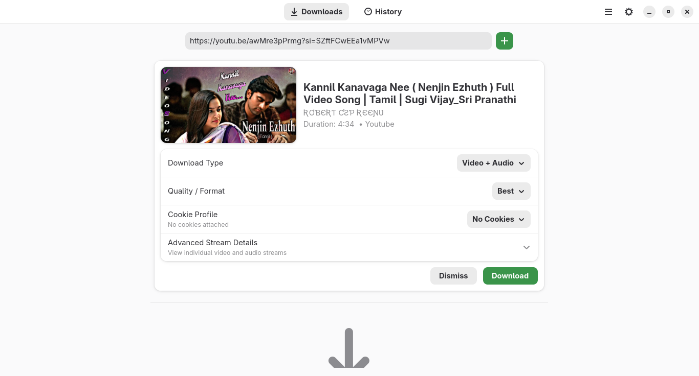</td>
    </tr>
    <tr>
      <td align="center"><b>Persistent Download History</b><br/>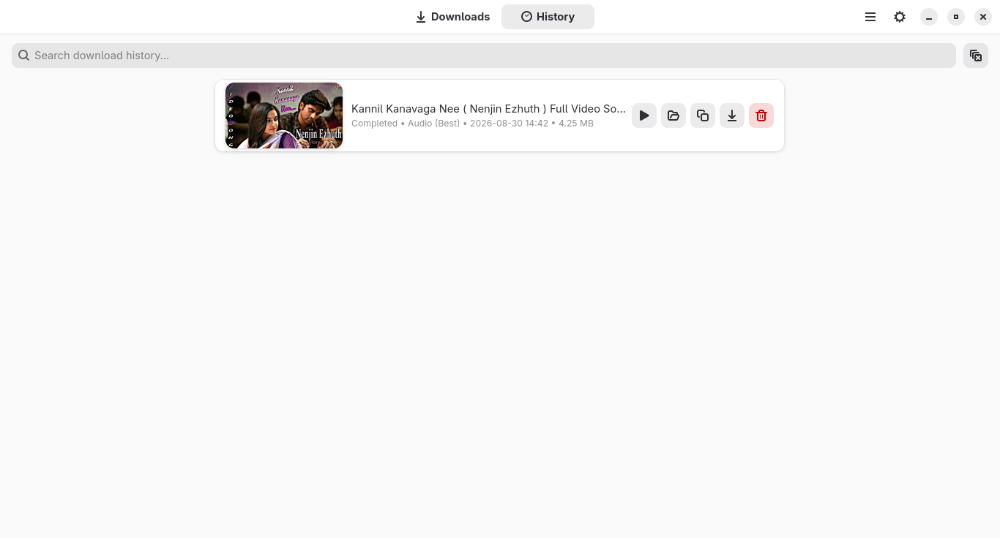</td>
      <td align="center"><b>Preferences & Settings</b><br/>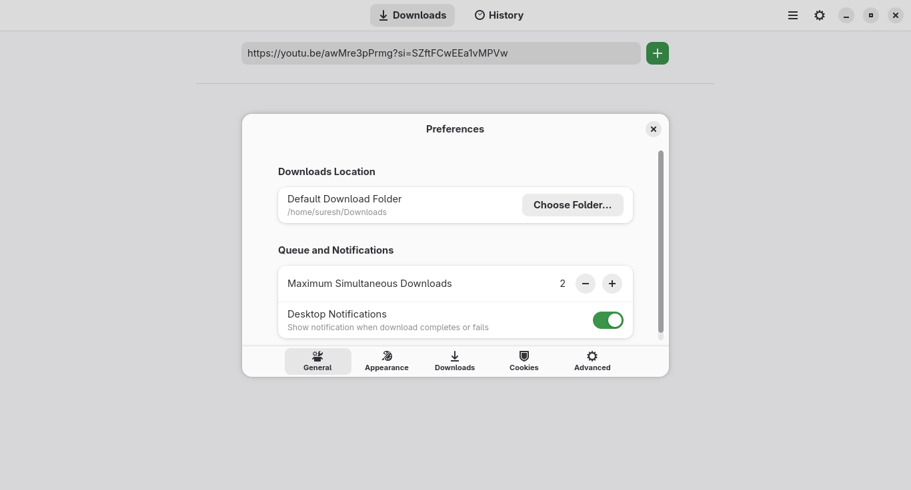</td>
    </tr>
  </table>
</div>

### 🪟 Windows Desktop Application (WinUI 3 & Windows App SDK)
<div align="center">
  <table>
    <tr>
      <td align="center"><b>Home & Metadata Preview</b><br/>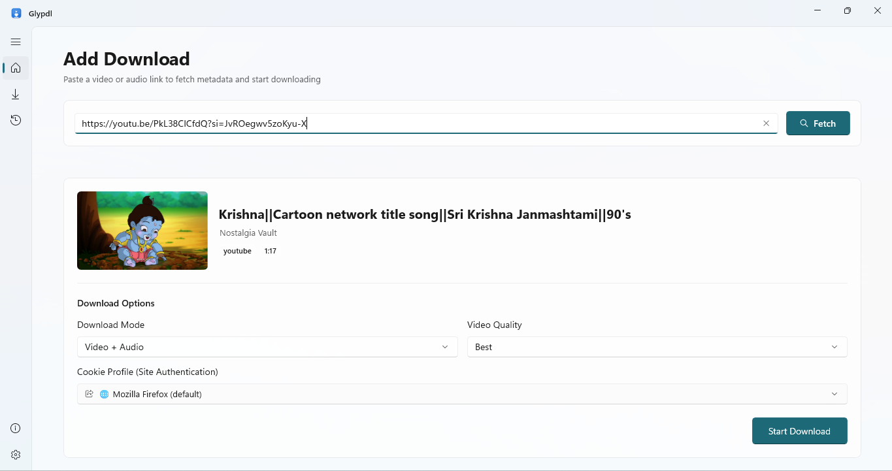</td>
      <td align="center"><b>Downloads Queue</b><br/>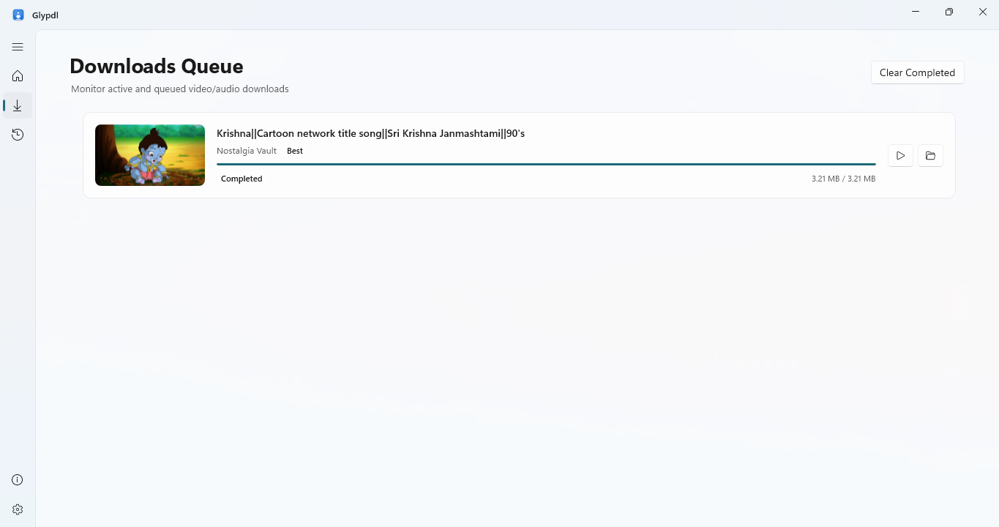</td>
    </tr>
    <tr>
      <td align="center"><b>Download History</b><br/>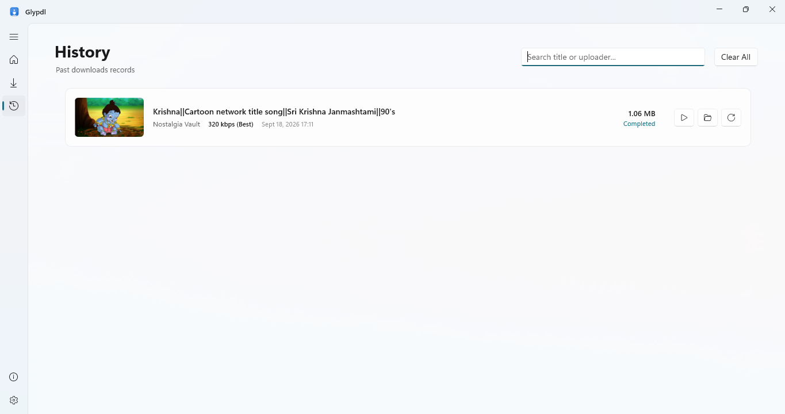</td>
      <td align="center"><b>Preferences & Settings</b><br/>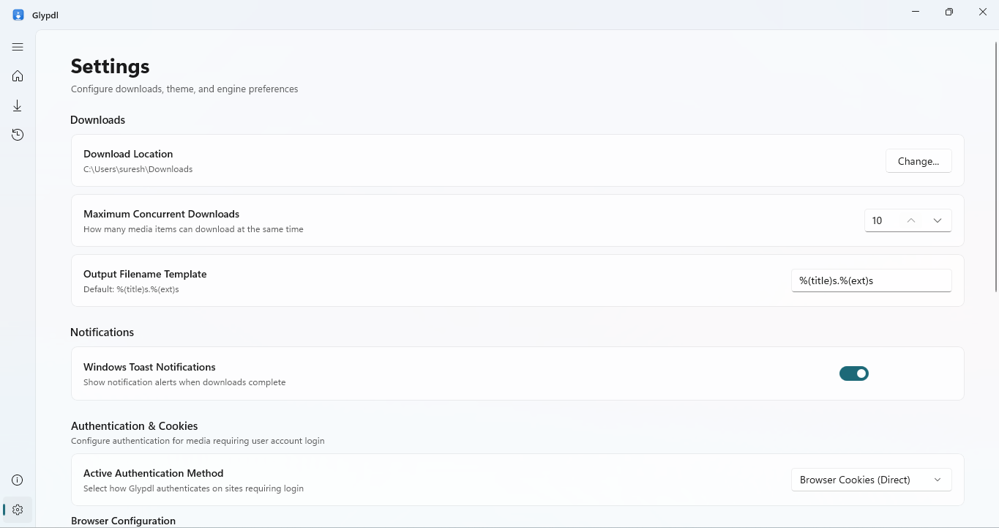</td>
    </tr>
  </table>
</div>

---

## 🚀 Key Features

### 🎬 1. Multi-Format Audio & Video Extraction
* **Video + Audio Mode**: Download in full quality up to **4K (2160p)**, **1440p**, **1080p**, **720p**, **480p**, **360p**, **240p**, **144p**, or **Best available**.
* **Audio-Only Extraction**: Direct extraction and conversion into **MP3**, **AAC**, **M4A**, **FLAC**, **WAV**, or **OPUS**.
* **Selectable Audio Bitrates**: `320 kbps (Best)`, `256 kbps (High)`, `192 kbps (Medium)`, `128 kbps (Standard)`, `96 kbps (Low)`.
* **YouTube Multi-Language Audio Streams**: Select your preferred spoken audio language (e.g. Tamil, English, Hindi, Spanish, French) from multi-track videos.
* **Subtitles & Closed Captions**: Download video subtitles in multiple languages (`ta`, `en`, `es`, etc.) with automatic fallback.

### 📋 2. Smart URL Input & Instant Metadata Analysis
* **Clipboard Auto-Detection**: Automatically detects video URLs from your clipboard on launch or upon pasting (`Ctrl+V` on desktop).
* **System Share Sheet Integration (Android)**: Tap "Share" from YouTube, Instagram, Facebook, TikTok, or browser apps and send links directly to Glypdl.
* **High-Resolution Metadata Preview**: Displays thumbnail artwork, title, channel/creator name, duration badge, source platform, and format selectors.
* **Non-Negotiable Anonymous Extraction**: Public videos and reels analyze and download anonymously by default without requiring user login.

### 🍪 3. In-App Authentication & Browser Cookie Support
* **Android In-App Session Browser**: Log in securely to Instagram, Facebook, YouTube/Google, TikTok, or Twitter/X via an isolated in-app WebView that automatically captures and saves session cookies in standard Netscape format.
* **Two-Phase Smart Extraction**: Tries anonymous download first. If a video is private, members-only, or age-restricted, it seamlessly retries using your saved session cookies.
* **Desktop Browser Cookie Extraction (Windows & Linux)**: Extracts cookies directly from installed browsers (**Chrome**, **Edge**, **Firefox**, **Brave**, **Opera**, **Vivaldi**, **Chromium**) with automatic profile and keyring detection.
* **Cookie File (`--cookies`)**: Full support for importing standard Netscape `cookies.txt` files across all platforms.
* **Strict Privacy Guarantee**: Cookies remain strictly local to your device and are never uploaded or transmitted to third-party servers.

### 📑 4. Visual Playlist Downloader
* **Interactive Playlist Inspector**: Displays full track lists with 16:9 thumbnail previews, index numbering, titles, uploaders, and durations.
* **Flexible Batch Control**:
  - One-tap **Select All (`✓`)** and **Deselect All (`✗`)**.
  - Individual item checkboxes for selective downloading.
  - Real-time status counter (e.g. `12 of 20 items selected`).
  - Batch action button (e.g. *"Download 12 Selected Videos"*).

### ⚡ 5. Real-Time Download Queue & Explorer Integration
* **Live Telemetry**: Real-time progress bar, transfer speed (MB/s), ETA countdown, downloaded and total file sizes.
* **Background Foreground Service (Android)**: Downloads continue reliably in the background with persistent status notifications even when the app is minimized.
* **Direct Player Launch (`▶`)**: Plays downloaded media immediately in your default media player.
* **Open Containing Folder (`📁`)**: Opens file manager with the exact downloaded file highlighted and selected.
* **Safe Overwrite Protection**: Uses `--no-overwrites` to prevent accidental data loss.

### 📜 6. SQLite History & Instant Search
* **Search-as-you-Type**: Filter download history instantly by title, channel, or URL.
* **One-Tap Re-download**: Re-download past media in different formats or quality levels directly from history.
* **Local SQLite Database**: Room DB on Android, SQLite on Windows and Linux for completely private offline record-keeping.

### ⚙️ 7. Automated Engine Provisioning & One-Click Updates
* **Zero Configuration**: Bundled with official `yt-dlp` and `FFmpeg` binaries. On Android, QuickJS (`libqjs.so`) and FFmpeg (`libffmpeg.so`) are packaged natively into architecture splits.
* **In-App Engine Updates**: Check for and install the latest `yt-dlp` stable releases directly from Settings with one tap.

### 🦊 8. Firefox & LibreWolf Companion Extension *(Linux)*
* **Real-Time Stream Detection**: Automatically detects HTML5 `<video>`, HLS (`.m3u8`), DASH (`.mpd`), YouTube, and TikTok streams as you browse.
* **One-Click Hand-off**: Send video URLs or active browser session cookies directly into Glypdl over secure native messaging IPC (`io.github.sureshsoudararajan.glypdl`).

---

## 📥 Installation

Choose the package suited for your operating system from [GitHub Releases](https://github.com/sureshsoudararajan/Glypdl/releases/latest):

### 📱 Android (`.apk`)
Download the APK corresponding to your device architecture from [GitHub Releases (v4.0.0)](https://github.com/sureshsoudararajan/Glypdl/releases/latest):
* **`Glypdl-4.0.0-arm64-v8a.apk`** &mdash; **Recommended for modern phones & tablets** (64-bit ARM)
* **`Glypdl-4.0.0-armeabi-v7a.apk`** &mdash; For legacy 32-bit ARM devices
* **`Glypdl-4.0.0-x86_64.apk`** &mdash; For Android Studio emulators and ChromeOS

*Open the `.apk` file on your device and follow the installation prompt (ensure "Install unknown apps" permission is granted).*

---

### 🪟 Windows 11 / 10 Installer (`.exe`)
1. Download **`Glypdl-4.0.0-Setup-x64.exe`** from [GitHub Releases](https://github.com/sureshsoudararajan/Glypdl/releases/latest).
2. Run the installer to create Start Menu and Desktop shortcuts.
3. Launch **Glypdl** from your Start Menu!

---

### 🐧 Linux Packages

#### 1. Universal Standalone AppImage
```bash
wget -O Glypdl-x86_64.AppImage https://github.com/sureshsoudararajan/Glypdl/releases/download/v4.0.0/Glypdl-x86_64.AppImage
chmod +x Glypdl-x86_64.AppImage
./Glypdl-x86_64.AppImage
```

#### 2. Debian / Ubuntu / Linux Mint / Pop!_OS (`.deb`)
```bash
wget -O glypdl.deb https://github.com/sureshsoudararajan/Glypdl/releases/download/v4.0.0/glypdl_4.0.0_all.deb
sudo apt install -y ./glypdl.deb
glypdl
```

#### 3. Fedora / Rocky Linux / RHEL / AlmaLinux (`.rpm`)
```bash
wget -O glypdl.rpm https://github.com/sureshsoudararajan/Glypdl/releases/download/v4.0.0/glypdl-4.0.0-1.fc44.noarch.rpm
sudo dnf install -y ./glypdl.rpm
glypdl
```

#### 4. Arch Linux / Manjaro / EndeavourOS
```bash
wget https://github.com/sureshsoudararajan/Glypdl/releases/download/v4.0.0/glypdl-4.0.0-1-any.pkg.tar.zst
sudo pacman -U ./glypdl-4.0.0-1-any.pkg.tar.zst
glypdl
```

#### 5. Flatpak (Sandboxed Container)
```bash
flatpak remote-add --if-not-exists flathub https://dl.flathub.org/repo/flathub.flatpakrepo
flatpak install -y flathub org.gnome.Platform//50 org.gnome.Sdk//50

# Build and run locally
flatpak-builder --user --install --force-clean build-dir packaging/flatpak/io.github.sureshsoudararajan.Glypdl.local.yaml
flatpak run io.github.sureshsoudararajan.Glypdl
```

---

## 🛠️ Building from Source

### Android Build (Kotlin & Jetpack Compose)
#### Prerequisites
1. Android SDK (API 34, Min SDK 26)
2. JDK 17+

```bash
cd android

# Run unit tests
./gradlew testReleaseUnitTest

# Assemble Release APKs (per-architecture splits)
./gradlew assembleRelease
# Generated APKs:
# android/app/build/outputs/apk/release/app-arm64-v8a-release.apk
# android/app/build/outputs/apk/release/app-armeabi-v7a-release.apk
# android/app/build/outputs/apk/release/app-x86_64-release.apk
```

---

### Windows Build (.NET 8 & WinUI 3)
#### Prerequisites
1. [.NET 8.0 SDK](https://dotnet.microsoft.com/download/dotnet/8.0)
2. [Visual Studio 2022](https://visualstudio.microsoft.com/) with **.NET Desktop Development** and **Windows App SDK C# Templates**
3. [Inno Setup 6](https://jrsoftware.org/isdl.php) (for installer generation)

```powershell
# Run unit tests
dotnet test windows\tests\Glypdl.Windows.Tests\Glypdl.Windows.Tests.csproj -c Release

# Publish self-contained executable
& "C:\Program Files\Microsoft Visual Studio\2022\Community\MSBuild\Current\Bin\MSBuild.exe" windows\src\Glypdl.Windows\Glypdl.Windows.csproj -t:Publish -p:Configuration=Release -p:Platform=x64 -p:RuntimeIdentifier=win-x64 -p:SelfContained=true -p:PublishDir=..\..\publish\

# Build setup installer (.exe)
& "$env:LOCALAPPDATA\Programs\Inno Setup 6\ISCC.exe" windows\packaging\inno\setup.iss
```

---

### Linux Build (Python & GTK4 / libadwaita)
#### Prerequisites
1. Python 3.10+
2. GTK4, libadwaita-1, PyGObject

```bash
git clone https://github.com/sureshsoudararajan/Glypdl.git
cd Glypdl

# Run automated tests
PYTHONPATH=src python3 -m tests

# Launch application
PYTHONPATH=src python3 -m glypdl.app
```

---

## ⌨️ Desktop Keyboard Shortcuts

| Shortcut | Action |
| :--- | :--- |
| <kbd>Ctrl</kbd> + <kbd>L</kbd> | Focus URL input field |
| <kbd>Ctrl</kbd> + <kbd>V</kbd> | Paste clipboard URL into input field |
| <kbd>Ctrl</kbd> + <kbd>H</kbd> | Switch to Download History view |
| <kbd>Ctrl</kbd> + <kbd>,</kbd> | Open Preferences dialog |
| <kbd>Ctrl</kbd> + <kbd>Q</kbd> | Quit Glypdl |
| <kbd>Escape</kbd> | Dismiss preview card or close modal dialog |

---

## 📂 Project Structure

```
Glypdl/
├── android/                        # Native Android app (Kotlin / Jetpack Compose)
│   ├── app/                        # Main Android application module
│   │   ├── src/main/java/          # Compose UI, Hilt DI, Room DB, Engine Services
│   │   ├── src/main/res/           # Vector icons, themes, layouts, raw assets
│   │   └── src/test/java/          # Android unit test suite
│   ├── build.gradle.kts            # Android Gradle project build file
│   └── settings.gradle.kts         # Android Gradle settings
├── data/                           # App icons, metadata, and screenshots
├── packaging/                      # Linux packaging (Deb, RPM, Flatpak, Arch, AppImage)
├── src/glypdl/                     # Linux GTK4 / Python application source
├── tests/                          # Linux test suite
├── windows/                        # Native Windows 11 client
│   ├── Glypdl.Windows.sln          # Visual Studio 2022 solution
│   ├── dist/                       # Output installer (.exe)
│   ├── packaging/inno/             # Inno Setup installer script & assets
│   ├── publish/                    # Published self-contained binaries
│   ├── src/Glypdl.Windows/         # WinUI 3 / C# application source
│   └── tests/Glypdl.Windows.Tests/ # xUnit test suite
├── CHANGELOG.md                    # Release version history
├── LICENSE                         # GNU General Public License v3.0
└── README.md                       # Project documentation
```

---

## 📁 File & Configuration Paths

### Windows
* **Configuration**: `%LOCALAPPDATA%\Glypdl\config.json`
* **Cookie Profiles**: `%LOCALAPPDATA%\Glypdl\profiles.json`
* **History Database**: `%LOCALAPPDATA%\Glypdl\history.db`
* **Bundled Binaries**: `%LOCALAPPDATA%\Glypdl\bin\` (`yt-dlp.exe`, `ffmpeg.exe`, `ffprobe.exe`)
* **Thumbnail Cache**: `%LOCALAPPDATA%\Glypdl\thumbnails\`

### Linux (XDG Base Directory)
* **Configuration**: `~/.config/glypdl/config.ini`
* **Cookie Profiles**: `~/.config/glypdl/profiles.json`
* **History Database**: `~/.local/share/glypdl/history.db`
* **Bundled Binaries**: `~/.local/share/glypdl/bin/`
* **Thumbnail Cache**: `~/.cache/glypdl/thumbnails/`

### Android
* **Database**: `/data/user/0/com.glypdl.android/databases/glypdl.db`
* **Cookies**: `/data/user/0/com.glypdl.android/files/cookies/`
* **Downloads**: `/storage/emulated/0/Download/Glypdl/`

---

## 📄 License

Glypdl is free and open-source software licensed under the **GNU General Public License v3.0 or later (GPL-3.0-or-later)** &mdash; see the [LICENSE](LICENSE) file for details.

Copyright © 2026 Suresh S.

### Third-Party Licenses & Notices
Glypdl utilizes independent third-party open-source components that retain their respective original licenses:
* **yt-dlp**: [The Unlicense](https://github.com/yt-dlp/yt-dlp/blob/master/LICENSE) / [MIT License](https://opensource.org/licenses/MIT)
* **FFmpeg**: [GNU Lesser General Public License (LGPL) v2.1+](https://www.ffmpeg.org/legal.html) / [GNU General Public License (GPL) v2+](https://www.gnu.org/licenses/old-licenses/gpl-2.0.html)
* **Jetpack Compose & AndroidX**: [Apache License 2.0](https://www.apache.org/licenses/LICENSE-2.0)
* **Windows App SDK & WinUI 3**: [MIT License](https://github.com/microsoft/WindowsAppSDK/blob/main/LICENSE)
* **libadwaita / GTK4**: [GNU LGPL v2.1+](https://gitlab.gnome.org/GNOME/libadwaita/-/blob/main/COPYING)
